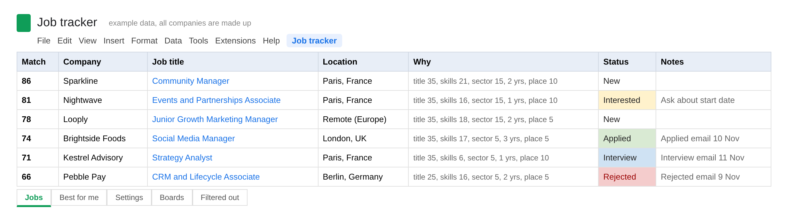
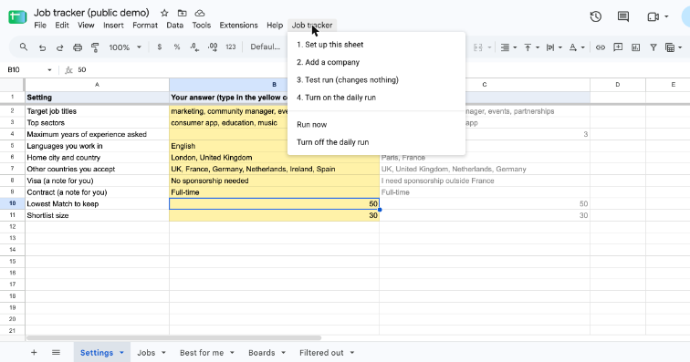
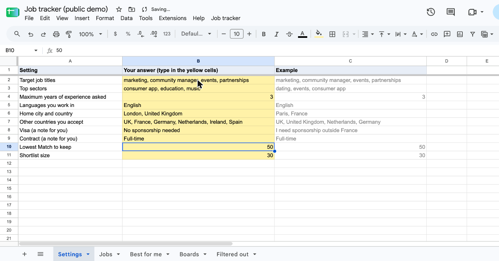
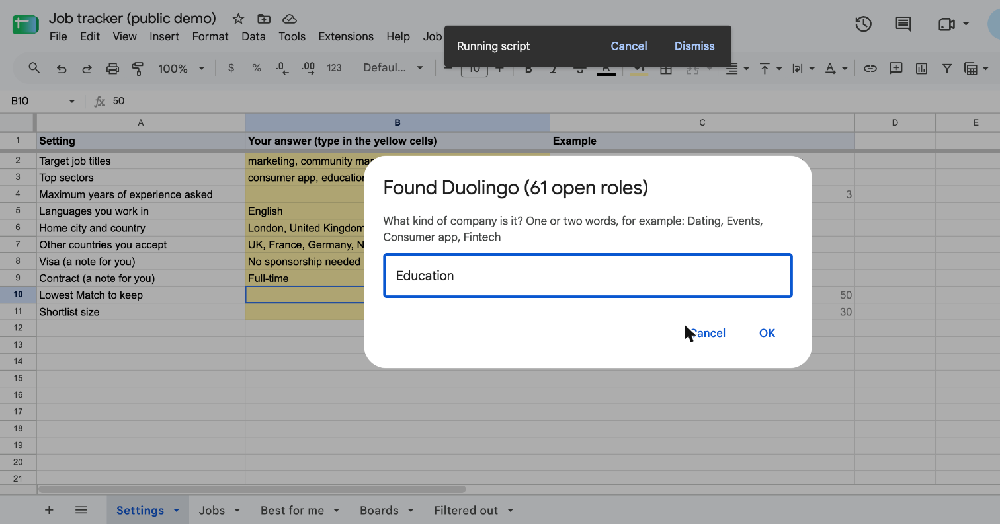
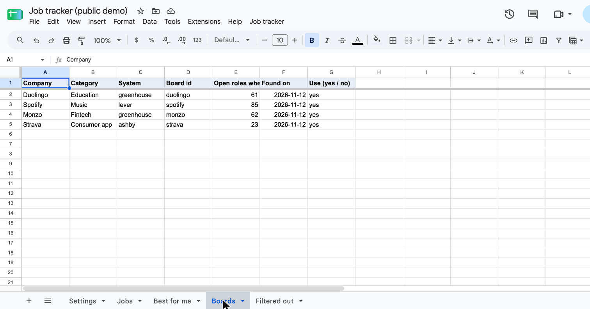
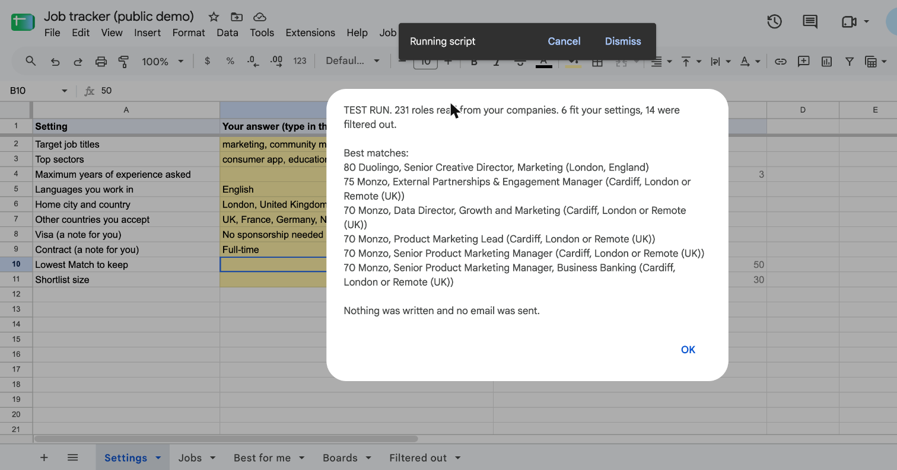

# Job tracker in a Google Sheet

A free job tracker that works by itself. Every morning it collects new roles from the companies you choose, removes the ones that don't fit you, reads your mailbox for replies, and emails you the best roles you haven't applied to yet.

The picture above uses made-up rows. The other pictures on this page are from a real test of the script in this repository.

You don't need to code, and you don't need a GitHub account. You copy 1 block of text, paste it once, and click 4 menu items. It takes about 30 minutes, once.

I built it for my own job search in Paris and wrote this guide so other people can use it.

By Maitrey Adapala.

## What it does

- **Finds roles for you.** Reads the job pages of the companies you pick, every day.
- **Filters them.** Drops roles that ask for too many years, require a language you don't speak, or are in the wrong country.
- **Ranks them.** Scores each role from 0 to 100 and shows you why.
- **Tracks your applications.** Reads your mailbox and marks roles as Applied, Interview or Rejected.
- **Emails you.** New roles and your best roles not applied to yet, every morning.
- **Costs nothing.** It runs in your own Google account. Your data stays there.

## Who it's for

Anyone looking for a job at companies that list their vacancies online, which covers most startups and tech companies. It works for any role and any country. You choose the companies.

## What you need

- A Google account (the one you use for Gmail).
- About 30 minutes.
- Optional: Claude, if you want it to do the setup for you (see the end of this page).

## Set it up in 5 steps

### Step 1: copy the script

On this page, above this text, there is a list of files. Click `Code.gs`, then click the copy button (2 small squares, top right of the file). The whole text is now copied.

### Step 2: make a new Google Sheet

Type `sheets.new` in your browser's address bar and press Enter. An empty Google Sheet opens. Click "Untitled spreadsheet" at the top left and name it "Job tracker".

### Step 3: paste the script and build the sheet

1. In your new sheet, click Extensions, then Apps Script. A new tab opens with a few lines of text in it.
2. Click in that text, select everything (Ctrl+A, or Cmd+A on a Mac) and paste (Ctrl+V, or Cmd+V). This is the text you copied in step 1.
3. Click the save button (the small disk icon at the top).
4. Close that tab, go back to your sheet and reload the page.

A new menu called **Job tracker** now appears at the top of your sheet, next to Help. You won't need the script tab again.

5. Click Job tracker, then "Set up this sheet". The tracker builds its tabs.

The first time you click a menu item, Google asks for permission. This is normal:
- Click OK or Continue, and choose your Google account.
- If you see "Google hasn't verified this app", click Advanced, then "Go to (your project name)". You see this because the script is your own private copy, not an app from a store.
- Click Allow. The tracker needs to read your sheet, read job pages, read your mailbox for replies, and send you an email. It only runs in your own account. Nobody else sees your data.
- Then click Job tracker, then "Set up this sheet" again.

### Step 4: say what you are looking for

Open the Settings tab and type your answers in the yellow cells. The cell next to each one shows an example. Separate several answers with commas.

| Line | What to type | Example |
|---|---|---|
| Target job titles | Job titles you would apply to. Keep them short | marketing, community manager, events, partnerships |
| Top sectors | The kinds of company you prefer | dating, events, consumer app |
| Maximum years of experience asked | 1 number | 3 |
| Languages you work in | The languages you can work in | English, Hindi |
| Home city and country | City first, then country | Paris, France |
| Other countries you accept | Write them the way job adverts do | UK, United Kingdom, Netherlands, Germany |
| Lowest Match to keep | 1 number. Start with 50 | 50 |
| Shortlist size | 1 number | 30 |

Remote roles are always kept. The visa and contract lines are notes for you. The tracker does not use them yet.

### Step 5: use the Job tracker menu

**1. Add a company.** Click Job tracker, then "Add a company". Type a company name, for example Duolingo, and click OK. The tracker finds that company's job page and tells you how many roles are open. It then asks what kind of company it is: type 1 or 2 words, for example Education, and click OK. Do this for 10 to 20 companies you would like to work for.

Each company you add appears on the Boards tab:

If the tracker says it found nothing for a company, check the spelling. Some companies use a job system the tracker can't read. Skip those.

**2. Test run.** Click Job tracker, then "Test run". After a moment a box shows how many roles it read and the best matches. Nothing is changed and no email is sent.

If nothing fits, add more companies or make your job titles shorter ("marketing", not "senior growth marketing manager").

**3. Turn on the daily run.** Click Job tracker, then "Turn on the daily run". That's it. You can close the sheet.

## What happens after that

Every morning at about 8am, with your computer off, the tracker:

- reads the job pages of your companies,
- keeps the roles that fit your settings and gives each one a score,
- reads your mailbox and marks roles as Applied, Interview or Rejected when a reply arrives,
- emails you the new roles and your best roles not applied to yet.

There is nothing to run or maintain. The only thing left for you is the job search itself: open the email, apply to the roles you like, and set their Status to Applied in the sheet. Set a role to "Not for me" to remove it from your shortlist.

To see a result straight away, click Job tracker, then "Run now".

## Prefer to let Claude do the setup?

If you use Claude with Claude in Chrome (paid Claude plans, at the time of writing), it can do steps 2 to 5 in your browser. Attach `Code.gs` and send this:

> Set up this job tracker for me in Google Sheets using Claude in Chrome. Make a new Google Sheet called "Job tracker", paste Code.gs into Extensions > Apps Script, save, reload the sheet and click Job tracker > Set up this sheet. Stop and let me click whenever Google asks for permission. Ask me for my target job titles, sectors, maximum years of experience, languages, home city and countries, then fill in the Settings tab. Add these companies with the Job tracker menu: [list your companies]. Do a test run and show me the result. When I say yes, turn on the daily run.

Claude can also improve the tracker for you later: add other job sites, change the scoring, or add a visa rule for your country.

## The tabs in your sheet

| Tab | What it is for |
|---|---|
| Settings | What you are looking for |
| Jobs | Every role the tracker kept. You only change Status and Notes |
| Best for me | Your shortlist: the best roles you haven't touched |
| Boards | The companies the tracker reads. Write "no" in the last column to switch one off |
| Filtered out | Roles that were rejected, with the reason, so they never come back |

## How the Match score works

Every role gets a score from 0 to 100. It is 5 parts added together. The Why column on each row shows the parts, for example "title 35, skills 8, sector 15, 2 yrs, place 10", so you can always see where a number came from.

| Part | Points | How it's decided |
|---|---|---|
| Title | 35 or 25 | 35 if the job title contains one of your target titles exactly. 25 if it contains all the words in another order. If neither, the role is skipped |
| Skills | 0 to 25 | The words from your target titles are looked up in the advert. All found gives 25, half gives 13 |
| Sector | 15 or 5 | 15 if the kind of company you typed when adding it is one of your sectors, otherwise 5 |
| Experience | 8 to 15 | 15 if the advert asks for 2 years or less, 12 for 3 years, 8 for more, 10 if no number is given |
| Place | 0 to 10 | 10 for your home city, 7 for your home country, 5 for another country you accept or remote, 3 if no place is given |

Example: "Community Manager" at a dating app in Paris asking for 2 years scores 35 + 8 + 15 + 15 + 10 = 83.

Anything below "Lowest Match to keep" on the Settings tab goes to Filtered out with the reason "low match". The score is a rough sort, not a judgement: it only counts words.

## Why a role is filtered out

- **Too many years.** The advert asks for more experience than your limit. A range counts at its lower end ("2 to 4 years" counts as 2).
- **Language.** The advert clearly requires a language you didn't list ("fluent French required"). A language called "a plus" is fine, and "the French market" is a place, not a language.
- **Place.** The role is in a country you didn't list and is not remote.
- **Low match.** The score is under your limit.

## Going further

This is the simple version of what I use. My own tracker also reads venture capital job boards, startup boards and LinkedIn, marks duplicates, and shows which sources bring roles. If you want those, ask Claude to add them to your copy. A few things I learned:

1. **Use sources that are open to being read.** Many job boards say in their site rules that robots are not allowed. Respect that. Company job pages on Greenhouse, Lever and Ashby are made to be read by other sites.
2. **If a job board is closed, go to the companies behind it.** I found 77 company job pages this way in 1 evening.
3. **Search inside your country.** On one board a worldwide search showed 1 Paris role in the first 20 results. The same search limited to France showed 20.
4. **Expect most roles to be filtered out.** On my venture capital boards about 1,000 roles were listed, 168 passed the title rules and 5 passed every filter. Those 5 were worth applying to.
5. **Check that the filter is not wrong.** I re-read 174 adverts and found 12 that required a language I don't speak and had slipped through.
6. **Mail matching fails on company names that are also normal words.** A rejection that said "apply to future roles" was once filed under a company called Future.

## Questions

**Is it really free?** Yes. It uses Google Sheets and Google Apps Script, which are free with a Google account.

**Is my data safe?** The tracker runs inside your own Google account. Nothing is sent to me or to anyone else. It reads your mailbox only to find replies to job applications, and it adds a label called "job-tracker" to the emails it has handled. It never deletes or sends anything except the daily email to you.

**Why did Google show a warning?** Because the script is your own private copy and not an app from a store. Google shows that warning for every personal script.

**A company I want is not found. Why?** The tracker reads companies whose careers page runs on Greenhouse, Lever or Ashby. Many large companies use other systems. Skip them, or ask Claude to add that system to your copy.

**No roles appear. What do I do?** Add more companies, make your job titles shorter, or lower "Lowest Match to keep" to 40.

**Senior roles appear in my list. Why?** The tracker drops a role only when the advert states a number of years above your limit. A title with "Senior" or "Director" and no number is kept. Set those to "Not for me", or ask Claude to add a rule that skips those words.

**How do I stop it?** Click Job tracker, then "Turn off the daily run".

**Can I change how it works?** Yes. The whole script is in `Code.gs`. If you don't code, give that file to Claude and say what you want changed.

## Files in this repository

| File | What it is |
|---|---|
| `README.md` | This guide |
| `job-tracker-example.xlsx` | An example of a filled tracker, with made-up rows. Only to look at: you don't need it for the setup |
| `Code.gs` | The script you paste once |
| `LICENSE` | The MIT licence |
| `docs/` | The images on this page |

## Help make it better

Found a problem or have an idea? Open an issue on this page (the Issues tab at the top). If you code, pull requests are welcome: support for more job systems is the most useful thing to add.

## Licence

MIT. Use it, change it and share it.
